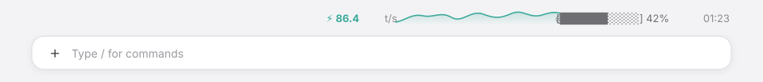

# token-speed

[](https://github.com/hermanzhaozzzz/claude-token-speed/releases)
[](https://code.claude.com/docs/en/plugins/mods/interface)
[](LICENSE)
[](https://github.com/hermanzhaozzzz/claude-token-speed/actions/workflows/validate.yml)

**Live token speed with its share of the 60-minute peak, a 3-minute history curve, cache hit rate, context usage, and the current turn timer — above the prompt in Claude Code and Claude Desktop, plus a one-click image cleanup for long sessions.**

[中文](README.zh-CN.md) · [Changelog](CHANGELOG.md)



## What it shows

One compact row, right-aligned on the band above the input box:

| Segment | Meaning |
|---|---|
| `⚡ 360.1 t/s · 76% of 472` | Current speed and its share of the 60-minute peak (`472 t/s`). Between turns it reads `0.0 t/s · 0%`. |
| 3-minute curve | One sample per second, smooth SVG line with an endpoint. The y-axis is pinned to the 60-minute peak; idle seconds sit at the baseline. It stretches or compresses with the band width while the speed number keeps its size. |
| `◎ 87%` | Session prompt-cache hit rate. Shows `—` until the provider reports cache reads. |
| `[██████░░░░] 42%` | Context-window usage and percentage. Shows `—` until the first usage report. |
| `01:23` | Current turn timer. Freezes at the final duration when the turn ends. |
| ⌫ 清图 | A button at the right end of the band, after the timer. Removes images from older tool-result rows locally (no model call), for sessions that have outgrown the provider's request-body limit. |

The row dims and the endpoint becomes hollow when the model is idle. It appears when the first turn starts and stays visible between turns, so you can compare the last few generations; the speed itself drops to `0.0 t/s` as soon as a turn ends.

## Install

### Claude Desktop (Code tab)

1. Click **+** next to the prompt box.
2. Choose **Plugins**.
3. **Add marketplace** with `hermanzhaozzzz/claude-token-speed`.
4. **Add plugin** and pick `token-speed`.

### Claude Code terminal

```bash
/plugin install token-speed --marketplace hermanzhaozzzz/claude-token-speed
```

From a shell:

```bash
claude plugin install token-speed --marketplace hermanzhaozzzz/claude-token-speed
```

Reload an existing session with `/reload-plugins`, or restart the desktop app.

## How the numbers are computed

- **Speed** — Hermes-style rolling throughput: `sum(output_tokens of the last ≤10 calls) / sum(API duration of those calls)`. A call's duration is measured from the model request to its final chunk, so it includes time-to-first-token. Before the first call of a turn completes, the row uses a 3-second live estimate; between turns it reads `0.0 t/s`.
- **Peak share** — `current speed / highest 1-second sample in the trailing 60 minutes`, capped at 100%. The peak slides with the window: once its sample ages out, the share recalibrates to the next highest value.
- **History** — The session samples the current speed once per second and keeps the last 180 samples (3 minutes). The chart's y-axis is the 60-minute peak rounded up to the next 50 t/s (minimum 100), so bursts stay comparable across the hour instead of each burst rescaling the axis. Idle seconds sample `0`, which makes generation bursts visible over the window.
- **Cache hit** — `cache_read / (input + cache_read + cache_creation)`, accumulated over the session. It is omitted (`—`) until the provider reports a cache read.
- **Context** — `context.percent` from `$.session.usage()`, refreshed every 2 seconds and on turn completion.
- **Timer** — Wall-clock time from `turn.start` to `turn.complete`, updated once per second.

## Clean images from a long session

Screenshots read into a session stay in its context as base64, and every request resends them. After enough of them, the request body can exceed a provider's size limit — private deployments often cap it at a few tens of MB — and both normal turns and `/compact` fail with `400 ... length limit exceeded`.

The **⌫ 清图** button at the right end of the band handles that:

- It answers the engine's `session.compact` hook with a message list that has the images removed. That is a **local compaction: no model call and no request**, so it still works after the current request body is over the limit.
- It keeps the first message, the newest 8 messages, and every older assistant message and user prompt as they are, so thinking and attachments such as PDFs survive.
- Only older **tool-result** rows are rebuilt: that drops the stored screenshot bytes, and the original image files are untouched.
- While a turn runs, the button asks you to wait; when there is nothing older to clean, it says so.
- The cleanup cannot be undone; read an image again if you need it back.

The button triggers the engine's compact event, but the plugin intercepts it: **no model call and no summarization happen**. The conversation is not condensed — only older tool-result screenshots are removed, and the first message, the newest 8 messages, assistant thinking, and user prompts stay whole. The transcript still shows the engine's “Compacted” notice because that is the event the button uses; it does not mean the context was summarized. Typing `/compact` yourself is different: that request is not intercepted and runs the normal model summarization, which can still fail on an oversized session.

In Claude Desktop the built-in security guard skips a user-installed mod's `session.compact` hook, so the button works in the terminal. Clicking the button in the desktop shows the guard warning and the exact one-command setup, with a copy action.

### Claude Desktop: one command

```bash
curl -fsSL https://raw.githubusercontent.com/hermanzhaozzzz/claude-token-speed/main/scripts/install-managed.sh | sudo bash
```

It installs the machine-level managed copy, removes the user-scope plugin and its marketplace (so the app cannot load a same-name `--plugin-dir` copy), and restarts Claude. It asks for the admin password once. Re-run it to update the managed copy, and do not also install the user-scope plugin on the same machine.

## Compatibility

| Plugin | Claude Code / Desktop | Status |
|---|---|---|
| 1.2.5 | 2.1.322 desktop (plugin API 2.1.321) | Validated |

This plugin uses the Claude Code **function-hooks plugin API**, which is early access and may change between releases. The repository includes a scheduled GitHub Action that runs `claude plugin validate .` against the latest Claude Code release every week, so an API change surfaces as a failed workflow instead of silently breaking the band.

If a Claude update makes a hook fail, the session prints a `<plugin>: ... hook skipped` notice. Run:

```bash
claude plugin validate .
```

and update `hooks/register.tsx` against the new declarations in `.claude-plugin/types/`.

### Updating for a new Claude Code release

1. Watch the weekly **validate** workflow, or run `claude plugin validate .` locally.
2. Open a session that loads the plugin. The engine writes fresh API declarations to `.claude-plugin/types/` (gitignored).
3. Adjust `hooks/register.tsx` and, if state changed, `types/index.d.ts`.
4. Run `claude plugin validate .`, bump `version` in `.claude-plugin/plugin.json`, add a `CHANGELOG.md` entry, commit, and tag a release.

## Development

```text
.claude-plugin/plugin.json   manifest
.claude-plugin/marketplace.json   local marketplace
hooks/hooks.json             hooks entry
hooks/register.tsx           the whole plugin
types/index.d.ts             state contract
```

Useful constants at the top of `hooks/register.tsx`:

| Constant | Default | Purpose |
|---|---|---|
| `ACCENT` | `#3AA99A` | Teal used by the speed number, curve, gradient and endpoint. The number and curve share one SVG so the color is exact. |
| `WINDOW_MS` | `3000` | Live estimate window before the first call completes. |
| `PEAK_WINDOW_MS` | `3600000` | Trailing window for the peak used by the percentage and the chart ceiling. |
| `PEAK_FLOOR` | `100` | Minimum chart ceiling before a peak exists. |
| `HISTORY_MAX` | `180` | Chart samples; 180 × 1 s = 3 minutes. |
| chart ceiling | 60-minute peak | Rounded up to the next 50 t/s, with `PEAK_FLOOR` as the minimum. |
| `CHART_W` / `CHART_H` | `220` / `24` | Chart viewBox and height. The rendered width follows the band's remaining space; the speed text stays in its own fixed-width SVG. |

After editing, run `/reload-plugins` in a session. The engine reloads the module and runs `session.start` again. Validate before committing:

```bash
claude plugin validate .
```

## Troubleshooting

- **The band is empty** — it appears from `turn.start`; send a prompt. If you just installed it, run `/reload-plugins` or restart the desktop app.
- **`0.0 t/s` between turns** — expected: the number follows the current turn, not the last one. The 3-minute curve keeps the recent generations.
- **`—` for cache or context** — the provider has not reported the value yet (no cache reads, or the first turn has not completed). The row fills in on later turns.
- **Terminal instead of desktop** — terminals have no `Svg`, so the plugin falls back to a 36-column block sparkline and a compact `· 76%` peak share; the rest of the row is unchanged.
- **The row disappeared after an app update** — run `claude plugin validate .` and check the session notice. The weekly CI job is there to catch this early.

## Privacy

Everything is computed locally from the session's own usage events. The plugin makes no network requests and reads no credentials. The clean button rewrites only the session's own conversation through the engine's compaction hook; it does not read or write your files.

## Uninstall

```bash
claude plugin uninstall token-speed
```

Remove the marketplace too if you no longer need it:

```bash
claude plugin marketplace remove claude-token-speed
```

## License

[MIT](LICENSE)
