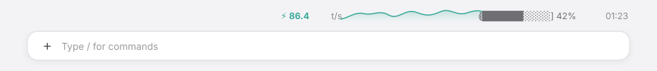

# token-speed

[](https://github.com/hermanzhaozzzz/claude-token-speed/releases)
[](https://code.claude.com/docs/en/plugins/mods/interface)
[](LICENSE)
[](https://github.com/hermanzhaozzzz/claude-token-speed/actions/workflows/validate.yml)

**在 Claude Code / Claude Desktop 输入框上沿显示实时 token 速度、3 分钟历史曲线、缓存命中率、上下文占用和本轮计时。**

[English](README.md) · [更新日志](CHANGELOG.md)



## 显示内容

输入框上沿一行，右对齐：

| 片段 | 含义 |
|---|---|
| `⚡ 86.4 t/s` | 最近最多 10 次 API 调用的滚动速度。 |
| 3 分钟曲线 | 每秒一个采样，平滑 SVG 曲线带端点；空闲秒回落到基线。 |
| `◎ 87%` | 会话级 prompt 缓存命中率。提供方还没报告缓存读取时显示 `—`。 |
| `[██████░░░░] 42%` | 上下文窗口占用与百分比。首轮完成前显示 `—`。 |
| `01:23` | 本轮计时；本轮结束后冻结在最终时长。 |

模型空闲时整行变暗、曲线端点变成空心。第一轮开始时出现，轮次之间保留，便于比较最近几次生成。

## 安装

### Claude Desktop（Code 标签页）

1. 点击输入框旁的 **+**。
2. 选择 **Plugins**。
3. **Add marketplace** 填入 `hermanzhaozzzz/claude-token-speed`。
4. **Add plugin**，选择 `token-speed`。

### Claude Code 终端

```bash
/plugin install token-speed --marketplace hermanzhaozzzz/claude-token-speed
```

或在 shell 中：

```bash
claude plugin install token-speed --marketplace hermanzhaozzzz/claude-token-speed
```

已打开的会话执行 `/reload-plugins`，或重启桌面版。

## 数字怎么算

- **速度** — Hermes 口径：`最近 ≤10 次调用的 output_tokens 之和 / 这些调用的 API 耗时之和`。单次耗时从请求发出到最后一个 chunk，包含首字延迟。首次调用完成前使用 3 秒实时估算。
- **历史** — 每秒采样一次，保留最近 180 个点（3 分钟）；空闲秒记为 `0`，因此能看出生成与停顿的分布。
- **缓存命中** — `cache_read / (input + cache_read + cache_creation)`，按会话累计；提供方没有缓存读取时显示 `—`。
- **上下文** — 取 `$.session.usage()` 的 `context.percent`，每 2 秒和每轮结束时刷新。
- **计时** — 从 `turn.start` 到 `turn.complete` 的墙钟时间，每秒更新。

## 兼容性

| 插件 | Claude Code / Desktop | 状态 |
|---|---|---|
| 1.0.0 | 2.1.322 桌面版（插件 API 2.1.321） | 已验证 |

本插件使用 Claude Code 的 **function-hooks 插件 API**，该 API 目前是 early access，版本之间可能变化。仓库里有一个每周定时运行的 GitHub Action，用最新 Claude Code 执行 `claude plugin validate .`，API 变化会直接体现为失败的工作流。

如果 Claude 升级后某个 hook 失效，会话会打印 `<plugin>: ... hook skipped`。执行：

```bash
claude plugin validate .
```

然后按照 `.claude-plugin/types/` 里的新声明更新 `hooks/register.tsx`。

### 适配新的 Claude Code 版本

1. 关注每周的 **validate** workflow，或在本地运行 `claude plugin validate .`。
2. 打开一个加载该插件的会话，引擎会把最新的 API 声明写到 `.claude-plugin/types/`（已 gitignore）。
3. 按新声明调整 `hooks/register.tsx`，状态结构变了再改 `types/index.d.ts`。
4. 运行 `claude plugin validate .`，更新 `.claude-plugin/plugin.json` 的 `version`，在 `CHANGELOG.md` 记一笔，提交并打新 tag。

## 开发

```text
.claude-plugin/plugin.json   清单
.claude-plugin/marketplace.json   本地 marketplace
hooks/hooks.json             hooks 入口
hooks/register.tsx           插件本体
types/index.d.ts             状态契约
```

`hooks/register.tsx` 顶部的主要常量：

| 常量 | 默认值 | 用途 |
|---|---|---|
| `ACCENT` | `#3AA99A` | 数字、曲线、渐变和端点使用的雾青。 |
| `WINDOW_MS` | `3000` | 首次调用完成前的实时估算窗口。 |
| `HISTORY_MAX` | `180` | 曲线采样数；180 × 1 秒 = 3 分钟。 |
| `SCALE_MAX` | `140` | 曲线固定上限（t/s）。 |
| `CHART_W` / `CHART_H` | `220` / `24` | SVG 尺寸（CSS 像素）。 |

修改后在会话里执行 `/reload-plugins`。提交前运行：

```bash
claude plugin validate .
```

## 常见问题

- **没有显示** — 它在 `turn.start` 时出现，先发一条消息试试；刚安装的话执行 `/reload-plugins` 或重启桌面版。
- **缓存或上下文显示 `—`** — 提供方还没报告该值（没有缓存读取，或首轮尚未完成），后续轮次会补上。
- **终端里没有曲线** — 终端不支持 `Svg`，会自动退回 36 列块字符曲线，其余部分不变。
- **桌面版升级后消失** — 运行 `claude plugin validate .`，查看会话提示；每周 CI 就是为了尽早发现这类问题。

## 隐私

所有数据都在本地根据会话自身的 usage 事件计算。插件不发起网络请求、不读取凭据、不写文件。

## 卸载

```bash
claude plugin uninstall token-speed
```

不再需要时也可以移除 marketplace：

```bash
claude plugin marketplace remove claude-token-speed
```

## 许可证

[MIT](LICENSE)
